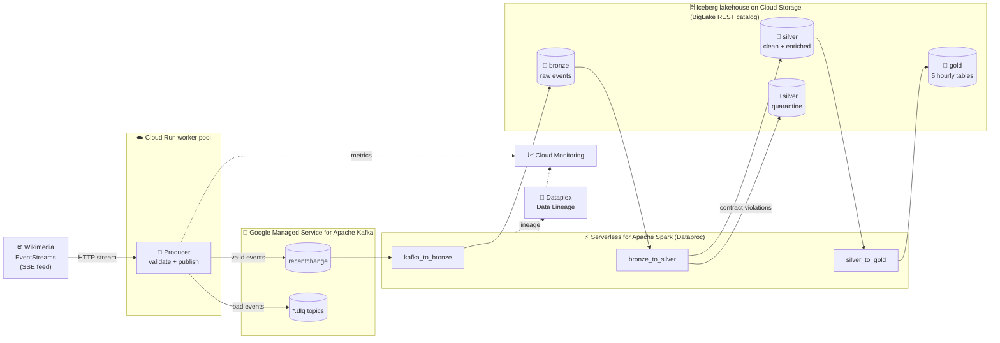
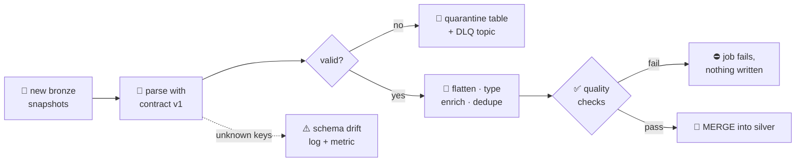
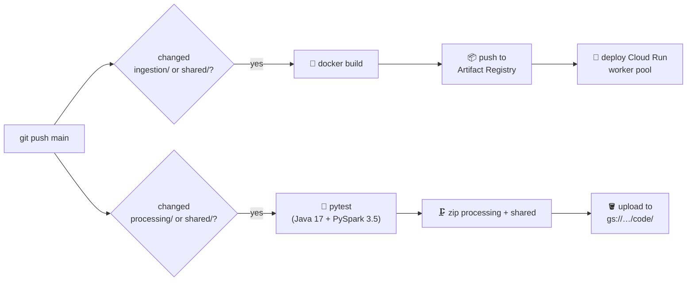

# 🌍 Wikimedia Real-Time Lakehouse

**A streaming data platform that turns every edit made on Wikipedia (and every other Wikimedia wiki) into analytics tables, about a minute after it happens.**


-4E8EE9)


Wikimedia publishes a public live feed of every change made on its ~1,000 wikis: edits, new pages, log actions and categorizations. That is roughly **25–50 events per second, or 2–4 million a day**. This project ingests the feed 24/7, moves it through a **Medallion lakehouse (🥉 Bronze → 🥈 Silver → 🥇 Gold)** stored as **Apache Iceberg** tables on Google Cloud, and produces hourly analytics tables: activity per wiki, bots vs humans, trending articles, edit sizes and edit-spike anomalies.

---

## 📑 Table of contents

1. [Architecture at a glance](#-architecture-at-a-glance)
2. [Tools and services used](#-tools-and-services-used)
3. [How the data flows, layer by layer](#-how-the-data-flows-layer-by-layer)
4. [Engineering capabilities demonstrated](#-engineering-capabilities-demonstrated)
5. [Data quality and reliability](#-data-quality-and-reliability)
6. [Observability](#-observability)
7. [CI/CD](#-cicd)
8. [Repository layout](#-repository-layout)
9. [Running it](#-running-it)
10. [Lessons learned](#-lessons-learned)

---

## 🧭 Architecture at a glance



The same flow, in plain text:

```
  🌐 Wikimedia            📨 Kafka              ⚡ Spark jobs (24/7)            🗄️ Iceberg on GCS
 ┌────────────┐   SSE   ┌──────────┐  1 min  ┌─────────────────┐         ┌──────────────────────┐
 │ recent     │ ──────▶ │ producer │ ──────▶ │ kafka_to_bronze │ ──────▶ │ 🥉 bronze.recentchange│
 │ change     │         │  (Cloud  │         └─────────────────┘         └──────────┬───────────┘
 │ feed       │         │   Run)   │                                                │ 1 min
 └────────────┘         └──────────┘         ┌─────────────────┐         ┌──────────▼───────────┐
                                             │ bronze_to_silver│ ──────▶ │ 🥈 silver.recentchange│
                                             └─────────────────┘         └──────────┬───────────┘
                                                                                    │ 5 min
                                             ┌─────────────────┐         ┌──────────▼───────────┐
                                             │ silver_to_gold  │ ──────▶ │ 🥇 gold.* (5 tables) │
                                             └─────────────────┘         └──────────────────────┘
```

---

## 🧰 Tools and services used

### ☁️ Google Cloud services

| Service | What it is | How this project uses it |
|---|---|---|
| **Cloud Run (worker pools)** 🏃 | Serverless containers. A *worker pool* is the Cloud Run flavor for always-on background workers that don't serve HTTP. | Runs the Python **producer** 24/7 as a single instance that reads the Wikimedia stream and writes to Kafka. |
| **Managed Service for Apache Kafka** 📨 | Google's fully managed Apache Kafka clusters. You don't patch brokers or run ZooKeeper/KRaft yourself. | The **event backbone**: the `recentchange` topic buffers events (7-day retention) between ingestion and processing, plus a `recentchange.backfill` topic and three **dead-letter topics** (`.dlq`, `.bronze.dlq`, `.silver.dlq`). Authentication is IAM-based (SASL/OAUTHBEARER with Google tokens), so there are no passwords to manage. |
| **Serverless for Apache Spark (Dataproc Serverless)** ⚡ | Runs Spark batches without provisioning or managing clusters. | Runs the three **PySpark Structured Streaming** jobs, each as a long-running batch (runtime 2.2, Spark 3.5). Executors are pinned at 2 per job to cap cost. |
| **Cloud Storage (GCS)** 🪣 | Object storage. | The **physical lakehouse**: Parquet data files and Iceberg metadata, Spark streaming checkpoints, the producer's checkpoint, error logs (JSONL) and the job code (`processing.zip`). One bucket, laid out as `<layer>/<thing>-<service>/`. |
| **BigLake Iceberg REST Catalog** 📚 | A managed Apache Iceberg catalog served over the standard Iceberg REST API. | The **table catalog** (`lakehouse.bronze`, `lakehouse.silver`, `lakehouse.gold`). Any Iceberg-compatible engine (Spark, BigQuery, Trino…) can read the same tables. |
| **Artifact Registry** 📦 | Private container image registry. | Stores the producer's Docker images, tagged with the git SHA and `latest`. |
| **Cloud Monitoring** 📈 | Google's metrics and dashboards backend. | Receives **OpenTelemetry** metrics: events received/published/malformed, reconnects, event lag histograms, rows per layer, quality check results and latencies. |
| **Dataplex Data Lineage** 🧬 | Google's data lineage graph, fed through an OpenLineage-compatible API. | Each job sends an **OpenLineage `RunEvent`**, so the Kafka → bronze → silver → gold graph shows up in the console. |
| **IAM / Service accounts** 🔐 | Identity and access management. | One runtime service account for Cloud Run and Spark. Everything authenticates through Application Default Credentials, so no secrets live in the code. |

### 🛠️ Open-source technologies

| Tool | What it is | How this project uses it |
|---|---|---|
| **Wikimedia EventStreams** 🌐 | Wikimedia's public **Server-Sent Events (SSE)** endpoint for real-time wiki changes. | The data source. The producer resumes from the last event after a restart with the `Last-Event-ID` header. |
| **Apache Kafka** 📨 | A distributed, durable, replayable event log. | Decouples ingestion from processing. Producer settings: idempotent, `zstd` compression, keyed by `wiki` so each wiki keeps its order within a partition. |
| **Apache Spark – Structured Streaming** ⚡ | A distributed engine for batch and streaming data. | All three transformations. They use `foreachBatch` micro-batches, `Trigger.ProcessingTime` (24/7) or `Trigger.AvailableNow` (catch up, then exit), and streaming reads from **Iceberg tables**. |
| **Apache Iceberg** 🧊 | An open table format: ACID transactions, snapshots, time travel, schema evolution and hidden partitioning on top of files. | Storage format for every table (format v2, Parquet). The jobs use `MERGE INTO`, partition overwrites, `expire_snapshots` maintenance and snapshot-based incremental reads. |
| **Apache Parquet** 🧱 | A columnar file format. | The data files under every Iceberg table. |
| **OpenTelemetry** 🔭 | A vendor-neutral standard for telemetry. | Counters and histograms exported to Cloud Monitoring from both the producer and the Spark jobs. |
| **OpenLineage** 🧬 | An open standard for lineage events. | The format of the lineage events sent to Dataplex. |
| **Docker** 🐳 | Containers. | Packages the producer (`python:3.12-slim`). |
| **GitHub Actions** 🤖 | CI/CD. | Two path-filtered workflows: build, push and deploy the producer, and test and upload the Spark jobs. |
| **pytest + local PySpark** 🧪 | Unit testing. | 48 unit tests for the silver and gold transformations, run against a real local Spark 3.5 on Java 17 (the same versions as Dataproc). |
| **confluent-kafka (librdkafka)** 🐍 | A fast Kafka client for Python. | The producer's Kafka client, with a custom OAuth callback that builds Google-signed tokens. |

---

## 🔄 How the data flows, layer by layer

### 1️⃣ Ingestion: the producer 🐍 → 📨

[`ingestion/producer/main.py`](ingestion/producer/main.py) runs on Cloud Run:

```
 SSE line ─▶ parse JSON ─▶ validate ──┬─ ✅ valid   ─▶ add ingested_at ─▶ Kafka "recentchange" (key = wiki)
                                      ├─ ❌ invalid ─▶ Kafka "recentchange.dlq" + JSONL error file on GCS
                                      └─ 🐤 canary  ─▶ dropped (Wikimedia's synthetic health events)

 every 30 s ─▶ flush Kafka ─▶ flush errors ─▶ save Last-Event-ID checkpoint to GCS
```

- **Exactly where it left off:** the checkpoint (the SSE `Last-Event-ID`) is saved to GCS only *after* Kafka has acknowledged every message. A crash replays a few seconds of events instead of losing them.
- **Resilience:** exponential backoff on reconnects (capped at 60 s, at most 8 failures in a row), graceful `SIGTERM` handling and a final flush.
- **Shared validation rules** ([`shared/validation.py`](shared/validation.py)): the producer and Spark use the same code. It rejects empty values, invalid JSON, `NaN`/`Infinity`, non-objects, missing required fields and unparseable timestamps.

### 2️⃣ 🥉 Bronze: `kafka_to_bronze`

Raw, append-only, *schema-on-read*. One row per Kafka message, with the payload kept **unmodified** in `raw_json`.

- **Idempotent writes:** an insert-only `MERGE` keyed on `(topic, partition, offset)` and bounded to the batch's partitions. Re-running a batch inserts nothing new.
- Invalid messages go to a Kafka DLQ and to error files on GCS.
- Partitioned by `year/month/day/hour` (UTC).

### 3️⃣ 🥈 Silver: `bronze_to_silver`

Clean, typed, deduplicated and enriched. One row per Wikimedia event (`meta_id`).



- **Data contract** ([`processing/contracts/recentchange_v1.py`](processing/contracts/recentchange_v1.py)): an explicit Spark schema built from Wikimedia's official JSON schema and checked against 21k real events. Spark never infers the schema.
- **Schema drift detection:** unexpected JSON keys are logged and counted, but they never fail the job.
- **Quarantine pattern:** rows that break the contract go to `silver.recentchange_quarantine` and a DLQ, with their error reason.
- **Enrichment:** `project` and `language` derived from the wiki's database name, canonical namespace names, anonymous/temporary-account detection, `length_delta` and an `edit_size_bucket`.
- **Deduplication** by `meta_id`. When an event arrives twice, the copy with the earliest Kafka timestamp and offset wins.

### 4️⃣ 🥇 Gold: `silver_to_gold`

Hourly aggregates of `silver.recentchange` in five Iceberg tables in `lakehouse.gold`, partitioned by `year/month/day/hour`, where the hour is the event hour in UTC.

| Table | One row per | Answers |
|---|---|---|
| 📊 `activity_hourly` | hour × wiki | How much activity each wiki has, split by event type, with bytes added and removed |
| 🤖 `bots_vs_humans_hourly` | hour × wiki × editor type | What share of the activity comes from bots, anonymous users and registered users |
| 🔥 `trending_pages_hourly` | hour × wiki × article | Which 20 articles were edited the most |
| 📏 `edit_size_hourly` | hour × wiki × size bucket | How large the edits are (silver's `edit_size_bucket`) |
| 🚨 `anomalies_hourly` | hour × wiki × page | Which pages had an edit spike: z-score > 3 against the previous 24 h, with at least 10 edits |

Every 5 minutes the job finds which event hours received new silver rows and **recomputes those whole hours**, so late events are absorbed into the right hour. It then replaces those partitions in each table. The open hour is provisional until its last events arrive.

**Every gold table carries the pipeline's timing,** so you can follow the end-to-end latency table by table:
- The timestamps of the previous layers (`event_ts`, `ingested_at`, `timestamp_kafka`, `timestamp_bronze`, `timestamp_silver`) hold the **maximum** over the row's events, that is, the latest event in the row.
- Their latencies (`latency_to_kafka`, `latency_to_bronze`, `latency_processing_bronze`, `latency_to_silver`, `latency_processing_silver`) hold the **average** in ms over those events.
- Each table also has its own gold fields:
  - `timestamp_gold_<table>`: when gold finished computing the table, right before writing it.
  - `latency_gold_<table>`: `timestamp_gold_<table> − timestamp_silver`.
  - `latency_processing_<table>`: the ms from the start of the gold batch (`gold_processed_at`) to that moment.

> ⚠️ **`unique_editors` and `unique_pages` can't be summed.** They are `COUNT(DISTINCT)` values: the same editor or page can show up in several hours, wikis or editor types, so summing the rows counts it more than once. To get distinct counts over a longer period or across several wikis, recompute them from `silver.recentchange`. Every other count (`total_events`, `edits`, `net_bytes`, …) can be summed.

> ℹ️ Anomaly scores need 24 hours of silver data before the scored hour. During the first 24 hours of the history, the baseline is incomplete and the job flags more pages than it should.

### ⏳ End-to-end latency tracking

Every row carries a timestamp from each step it went through, so you can measure **where the time goes** with a single query:

```
event_ts ──▶ ingested_at ──▶ timestamp_kafka ──▶ timestamp_bronze ──▶ timestamp_silver ──▶ timestamp_gold_<table>
   🌐            🐍                📨                   🥉                    🥈                     🥇
         ╰─latency_to_kafka─╯╰──latency_to_bronze──╯╰──latency_to_silver──╯╰──latency_gold_<table>──╯
```

---

## 💡 Engineering capabilities demonstrated

| Capability | Where |
|---|---|
| 🌊 **Real-time stream processing** with Spark Structured Streaming (micro-batches, `foreachBatch`, streaming reads from Iceberg) | `processing/jobs/*` |
| 🔁 **Three run modes per job**: `continuous` (24/7), `stream` (catch up and exit) and `backfill` (replay a given hour) | [`processing/common/streaming.py`](processing/common/streaming.py) |
| ♻️ **Idempotency everywhere**: insert-only MERGE in bronze and silver, whole-partition overwrite in gold, checkpoint-after-ack in the producer | [`processing/common/iceberg.py`](processing/common/iceberg.py) |
| 🏅 **Medallion architecture** on an **open table format** (Iceberg v2) | [`processing/migrations/`](processing/migrations/) |
| 📜 **Data contracts** and **schema-drift detection** | [`processing/contracts/`](processing/contracts/) |
| 🚧 **Dead-letter queues and quarantine tables**: bad data is isolated, never silently dropped | producer, bronze and silver |
| ✅ **A reusable data-quality framework** (null ratios, uniqueness, volume, sums-to-1, reconciliation against silver) | [`processing/common/quality.py`](processing/common/quality.py) |
| ⏰ **Late-data handling**: event-time partitioning, and recomputing any hour that gets late events | silver and gold |
| 🧮 **Analytics engineering**: window functions, top-N per group, z-score anomaly detection over a rolling 24 h baseline | [`processing/jobs/silver_to_gold.py`](processing/jobs/silver_to_gold.py) |
| 🗃️ **Schema-as-code migrations**: idempotent DDL that runs at the start of every job | [`processing/common/migrations.py`](processing/common/migrations.py) |
| 🧊 **Table maintenance**: snapshot expiry and metadata cleanup to keep commits healthy in a 24/7 job | `maintain()` in `iceberg.py` |
| 🔐 **Keyless auth**: IAM-based Kafka auth (OAUTHBEARER) and ADC everywhere | [`shared/kafka_client.py`](shared/kafka_client.py) |
| 💰 **Cost control**: fixed executor count, TTL on every batch, a single producer instance | `processing/scripts/*.sh` |
| 🧪 **Testing**: unit tests on a real local Spark with fixture data | [`tests/`](tests/) |
| 🚀 **CI/CD**: path-filtered workflows, tests gate deployment, images tagged by commit SHA | [`.github/workflows/`](.github/workflows/) |
| 📈🧬 **Observability and governance**: OpenTelemetry metrics and OpenLineage lineage | `shared/telemetry.py`, `processing/common/lineage.py` |

---

## ✅ Data quality and reliability

**Silver checks** (a critical failure stops the batch *before* anything is written):

| Check | Rule |
|---|---|
| `meta_id_not_null`, `meta_id_unique` | The row key must be present and unique |
| `event_ts_not_null` | Every row needs an event time |
| `quarantine_ratio` | ≤ 1 % of the rows quarantined |
| `wiki` / `type` / `title` null ratio | ≤ 1 % nulls |
| `min_volume` | ≥ 30k rows/hour in backfill (a sign the producer is broken). In streaming mode it only warns. |

**Gold checks:** no negative counts, no duplicate keys, percentages per wiki and hour that add up to 1, at most 20 trending pages per group, and a **reconciliation check** that `total_events` matches a count taken directly from silver.

**Failure handling at a glance:**

```
 💥 crash?          ─▶ restart from the Spark / producer checkpoint, MERGE makes the replay harmless
 🧟 malformed data? ─▶ DLQ topic + quarantine table / error JSONL, with the reason attached
 🐢 late events?    ─▶ partitioned by event time, the affected hours are recomputed
 📉 bad batch?      ─▶ critical quality check fails, nothing is committed, alert in the logs
```

---

## 📈 Observability

- **Metrics (OpenTelemetry → Cloud Monitoring):** `events_received`, `events_published`, `events_malformed{reason}`, `events_dropped{reason}`, `reconnects`, an `event_lag_ms` histogram, rows read/written/quarantined per job, quality checks passed/failed per check, and processing-latency histograms.
- **Structured logs:** quality results are emitted as JSON lines (`"log": "quality_checks"`) so they are easy to filter in Cloud Logging.
- **Lineage (OpenLineage → Dataplex):** every job reports its inputs and outputs.
- **Latency columns** in every table (see [End-to-end latency tracking](#-end-to-end-latency-tracking)).

---

## 🚀 CI/CD



- **`deploy-producer.yaml`:** builds the image for `linux/amd64`, tags it with the commit SHA, and deploys it to the Cloud Run worker pool with VPC egress so it can reach the private Kafka cluster.
- **`upload-jobs.yaml`:** runs the unit tests first. Only if they pass does it package `processing/` and `shared/` and upload them to GCS for Dataproc to use with `--py-files`.

---

## 📂 Repository layout

```
.
├── 🐍 ingestion/producer/      Wikimedia SSE ➜ Kafka (Dockerfile, main.py)
├── 🔗 shared/                  Code used by the producer AND by Spark
│   ├── wikimedia_client.py      SSE reader with resume (Last-Event-ID)
│   ├── kafka_client.py          Kafka producer with Google OAuth
│   ├── validation.py            One set of validation rules for every layer
│   ├── checkpoint.py / gcs.py   Checkpoints and files on Cloud Storage
│   ├── error_sink.py            Buffered JSONL error logs, partitioned by hour
│   └── telemetry.py             OpenTelemetry ➜ Cloud Monitoring
├── ⚡ processing/
│   ├── jobs/                    kafka_to_bronze · bronze_to_silver · silver_to_gold
│   ├── common/                  Spark session, Iceberg helpers, quality, lineage, metrics
│   ├── contracts/               recentchange_v1 data contract
│   ├── migrations/              001 bronze · 002 silver · 003 gold (Iceberg DDL)
│   └── scripts/                 gcloud submit scripts for Dataproc Serverless
├── 🧪 tests/                    Unit tests + JSONL/CSV fixtures
└── 🤖 .github/workflows/        CI/CD
```

---

## 🏁 Running it

**Prerequisites:** a GCP project with Managed Kafka, a GCS bucket, a BigLake catalog and a service account. Set the values in [`processing/common/config.py`](processing/common/config.py), the submit scripts and the workflows.

```bash
# 🧪 Run the tests locally (needs Java 17)
pip install -r requirements-dev.txt
pytest -q

# ⚡ Start the three streaming jobs 24/7 (each one runs for up to 7 days per batch)
NOW=$(date -u +"%Y %m %d %H")
processing/scripts/submit_kafka_to_bronze.sh  $NOW continuous
processing/scripts/submit_bronze_to_silver.sh $NOW continuous
processing/scripts/submit_silver_to_gold.sh   $NOW continuous

# ⏪ Rebuild a past hour (e.g. 2026-11-21 10:00 UTC, plus the hour before)
processing/scripts/submit_silver_to_gold.sh 2026 11 21 10 backfill
```

The producer is deployed automatically by GitHub Actions on every push to `main` that touches `ingestion/` or `shared/`.

| Mode | Behavior |
|---|---|
| `continuous` 🔁 | 24/7 micro-batches (1 min for bronze and silver, 5 min for gold) |
| `stream` ▶️ | Processes everything pending, then exits (good for scheduled runs) |
| `backfill` ⏪ | Reprocesses a given hour and the hour before it. Use it for history that the stream can no longer see, since silver keeps only 6 h of snapshots. |

---

## 🎓 Lessons learned

- 🧊 **Iceberg metadata grows with every commit.** A streaming job that commits every minute added ~900 bytes of snapshot history per commit. After about 1,150 commits the metadata file passed the catalog's ~1 MiB limit and the job died. The fix was periodic `expire_snapshots` (6 h retention) and automatic cleanup of old `metadata.json` files, run from inside the job.
- 🌐 **Don't trust `server_name` for attribution.** Central-login events from every wiki arrive as `auth.wikimedia.org`. `project` and `language` are now derived from the wiki's database name instead.
- ☕ **Pin the runtime in CI.** Spark 3.5 fails on Java 23+, so CI pins Java 17 and Python 3.11, the same as the Dataproc runtime 2.2.
- 💸 **Serverless isn't automatically cheap.** Fixed executor counts and TTLs keep a 24/7 pipeline within a hobby budget.

---

<p align="center">Built as a portfolio project to show end-to-end streaming data engineering on Google Cloud. ⭐</p>
